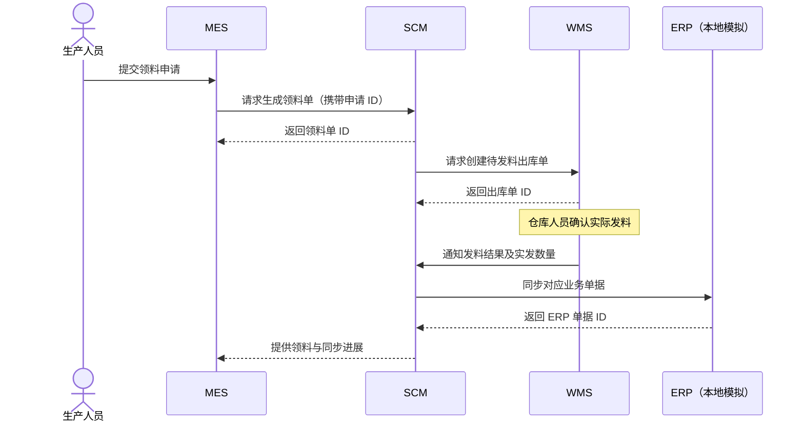

# 生产领料链路（待实现设计）

## 用户已明确的范围

- MES：生产执行，生产人员发起领料申请单。
- SCM：调拨、生产订单履约，根据申请生成领料单。
- WMS：管理仓库库存，执行仓库发料。
- ERP：金蝶方向的单据同步，本地先建立模拟服务。
- 四个后端统一采用 GoFrame 框架。

以下流程和接口是后续实施建议，不代表当前已经提供这些业务能力。

## 单据边界

| 单据 | 归属系统 | 意义 |
| --- | --- | --- |
| 领料申请单 | MES | 生产人员提出针对某生产订单的用料需求 |
| 领料单 | SCM | 受理申请后形成的履约与发料依据 |
| 出库单 | WMS | 仓库执行拣货、发料和实物库存扣减的依据 |
| ERP 同步记录 | SCM | 记录同步状态、错误及 ERP 返回的单据标识 |
| ERP 对应单据 | ERP | 按实际金蝶产品和单据类型映射，暂不假定具体表单 |

申请不等于已经领到物料，生成领料单不等于已经出库。只有 WMS 确认发料后，才能把对应数量记录为已发出。

## 建议的第一条链路

SCM 建议作为协调方，保存 MES 申请 ID、SCM 领料单 ID、WMS 出库单 ID 和 ERP 单据 ID 的关联。第一版可由 MES 查询 SCM 获取进展，后续再练事件回传。

默认建议在 WMS 确认发料后同步实发数据到 ERP。用户目前仅指定了需要同步到金蝶，尚未确定是领料单生成时同步计划数据，还是发料后同步实绩；真实开发前需确认这个业务时点。

ERP 同步状态与仓库出库状态应分别记录。ERP 暂时不可用时，不能把已经发生的仓库发料标记成未发生；保留待同步任务再重试。

## 建议接口（尚未实现）

| 系统 | 接口 | 意图 |
| --- | --- | --- |
| MES | `POST /api/v1/material-requisitions` | 提交领料申请 |
| MES | `GET /api/v1/material-requisitions/{id}` | 查看申请及履约进展 |
| SCM | `POST /api/v1/material-issues` | 根据申请幂等生成领料单 |
| SCM | `GET /api/v1/material-issues/{id}` | 查询发料及 ERP 同步状态 |
| WMS | `POST /api/v1/outbound-orders` | 根据领料单幂等创建待发料出库单 |
| WMS | `POST /api/v1/outbound-orders/{id}/confirm` | 确认实发，原子扣减库存 |
| SCM | `POST /api/v1/material-issues/{id}/warehouse-result` | 接收并幂等处理发料结果 |
| ERP 模拟 | `POST /api/v1/material-issues` | 幂等接收待同步单据 |

接口名称仅代表本地练习契约，不对应真实金蝶 WebAPI。

第一版建议一张申请只对应一张领料单和一张出库单，并只支持一次全量发料。部分发料、多仓拆单、替代料、退料和取消流程分别作为后续练习。

## 练习顺序与验收

1. **同步 HTTP 链路**：MES → SCM → WMS 建单；仓库确认后 SCM → ERP。可以按申请 ID 查回全部关联单据。
2. **重复请求与超时**：建单以来源系统和来源单号去重；发料确认重复调用不重复扣库存。模拟下游已成功但响应丢失，重试仍返回原单据。
3. **持久化与失败恢复**：各系统独立保存数据，不跨库写表。SCM/WMS 等进程在本地写入后、发通知前崩溃，重启后仍能恢复待办。
4. **异步事件与可靠投递**：将发料结果与 ERP 同步改为异步，练习本地事务 + outbox、重复消费、重试和失败记录。ERP 停机期间不丢单，恢复后可继续同步。
5. **履约扩展**：增加生产订单、锁库、调拨、部分发料及退料，并明确各自状态变化。

每个阶段都增加对应故障实验。最初先验证一条真实跨进程请求链路，再逐步引入数据库和队列。
